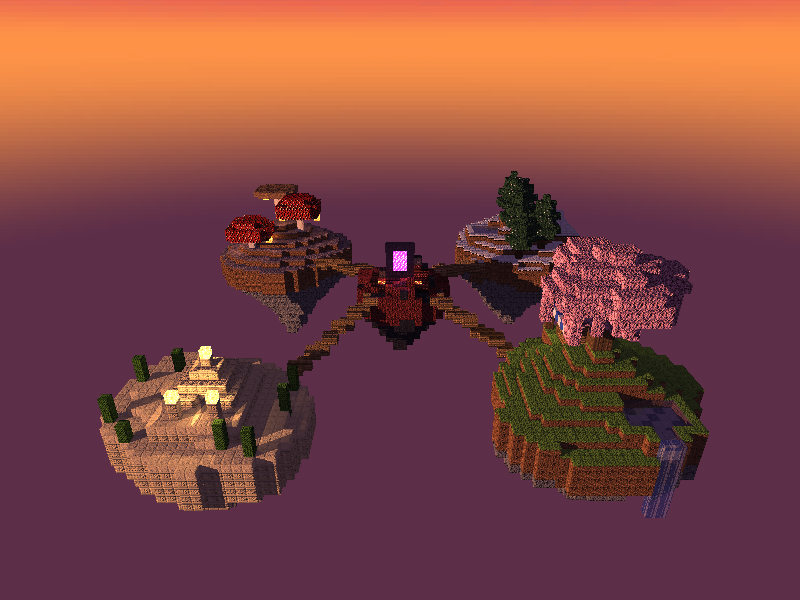
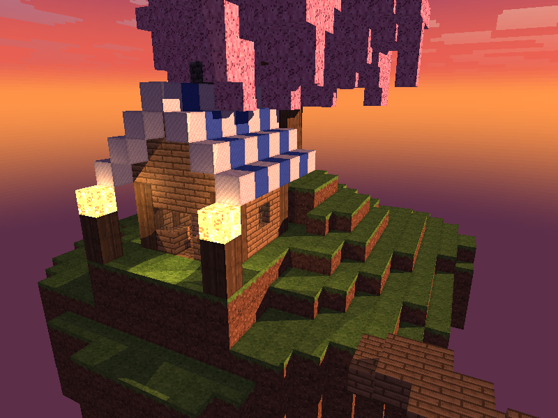
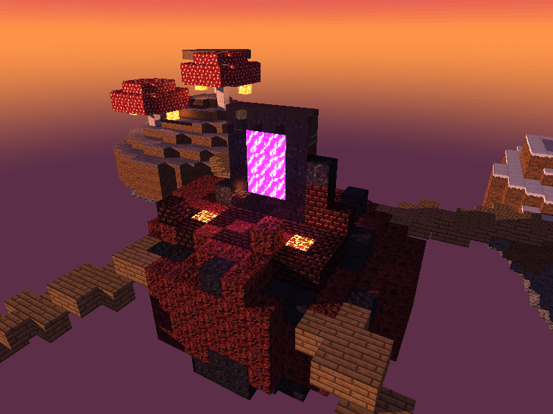
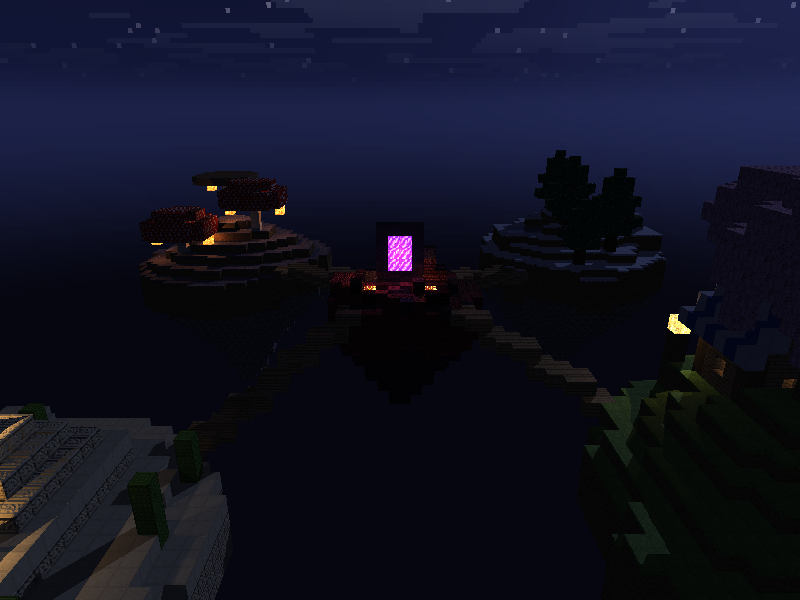

# Diorama Minecraft — Raytracer en Rust

Raytracer en CPU que dibuja un archipiélago de islas flotantes al estilo de Minecraft. Todo el raytracing, las matemáticas, las texturas y el terreno están hechos a mano con la librería estándar de Rust. 

## Video

[](https://youtu.be/2Hx4Tthe7TE)

clic en la imagen para ver el video.

## Cómo correrlo

```bash
cargo run --release
```

Requiere Rust (edición 2024). Hay que usar `--release`: en modo debug el raytracer es mucho más lento.

## Controles

| Tecla | Acción |
|---|---|
| Flechas | Girar e inclinar la cámara |
| `W` / `S` | Acercar y alejar |
| `0` | Vista general |
| `1` a `5` | Ir a cada isla: sakura, desierto, hongos, nieve, portal |
| `L` | Cambiar entre atardecer y noche |
| `G` | Generar otro archipiélago con otra semilla |
| `N` | Prender o apagar los mapas normales |
| `T` | Cambiar entre 1 hilo y todos (el tiempo sale en la terminal) |

## La escena

Cuatro islas en las esquinas, unidas con puentes de madera a una isla pequeña en el centro.

| Isla | Contenido |
|---|---|
| Sakura | Árbol de cerezo, estanque con cascada y cabaña con ventanas de vidrio, lámpara y faroles |
| Desierto | Pirámide de arenisca con glowstone en la punta y en la entrada, y cactus |
| Hongos | Hongos rojos y café gigantes con shroomlight bajo el sombrero |
| Nieve | Pinos, lago congelado (hielo sobre agua) e iglú con lámpara |
| Portal | Portal del Nether en ruinas, solo con bloques del Nether y magma |





## Rúbrica

| Requisito | Cómo se cumple | Código |
|---|---|---|
| Rotación y zoom | Cámara orbital con coordenadas esféricas y cambio de base | `camera.rs` |
| 5 materiales | 32 bloques, cada uno con textura propia y sus parámetros (tabla abajo) | `terrain.rs`, `texture.rs` |
| Reflexión | Rayo reflejado recursivo (hasta 3 rebotes) en agua, vidrio, hielo y obsidiana | `render.rs` |
| Refracción | Ley de Snell, reflexión interna total y Fresnel (Schlick) en agua, cascada, vidrio de la cabaña y hielo | `vec3.rs`, `render.rs` |
| Mapas normales | Normal calculada desde la textura de cada cara con diferencias finitas y base TBN por cara del cubo. Relieve fuerte en piedra y ladrillos, y suave en pasto, tierra, madera, hojas, nieve y hongos | `texture.rs`, `cube.rs` |
| Material emisivo | Portal, magma, glowstone y shroomlight brillan y además iluminan su alrededor con luces puntuales (19 luces) | `structures.rs`, `light.rs` |
| Skybox | Cubemap de 6 caras de 256×256 generado por código: atardecer y noche, con sol y luna cuadrados, nubes y estrellas | `skybox.rs` |
| Terreno procedural | Ruido propio (value noise y fBm) con semilla. Cada isla cubre más de 16×16 columnas | `noise.rs`, `terrain.rs` |
| Paralelismo y optimización | Ver la sección siguiente | `render.rs`, `world.rs` |

## Optimización

- **Mundo de voxels con 3D-DDA.** El rayo recorre la cuadrícula celda por celda y se detiene en el primer bloque. El costo depende de la distancia que recorre, no de la cantidad de bloques. Con la misma escena de prueba bajó de 62 ms (lista de cubos) a 5.8 ms.
- **Hilos.** `std::thread::scope` reparte la imagen en bandas de filas. Cada hilo escribe solo en su banda, sin locks sobre los píxeles.
- **Resolución adaptable.** Mientras la cámara se mueve se lanza un rayo por cada bloque de 2×2 píxeles. Al soltar las teclas se traza completa.
- **Solo se traza cuando algo cambia.** Si la cámara no se mueve, no se recalcula la imagen.
- **Luces cercanas.** No se lanza rayo de sombra si la cara le da la espalda a la luz o si la luz está a más de 14 bloques.

Tiempo de un render completo de 800×600 en la vista general (Intel i7-13620H, 16 hilos):

| Hilos | Tiempo |
|---|---|
| 1 | 115 ms |
| 2 | 58 ms |
| 4 | 30 ms |
| 8 | 17 ms |
| 16 | 11 ms |
| 16, en movimiento (1 rayo cada 2×2) | 2.8 ms |

## Materiales

Albedo = [difuso, especular, reflectividad, transparencia]. La lista completa está en `src/terrain.rs`.

| Bloque | Albedo | Especular | IOR | Emisión | Extra |
|---|---|---|---|---|---|
| Pasto | 0.9, 0.1, 0, 0 | 10 | 1.0 | 0 | |
| Piedra | 0.8, 0.25, 0, 0 | 30 | 1.0 | 0 | Mapa normal |
| Tablas | 0.8, 0.2, 0, 0 | 20 | 1.0 | 0 | |
| Hojas de cerezo | 0.9, 0.1, 0, 0 | 8 | 1.0 | 0 | |
| Agua | 0.45, 0.6, 0.1, 0.75 | 80 | 1.33 | 0 | Reflexión y refracción |
| Cascada | 0.6, 0.5, 0.1, 0.45 | 60 | 1.33 | 0 | Reflexión y refracción |
| Vidrio | 0.1, 0.6, 0.08, 0.85 | 120 | 1.5 | 0 | Reflexión y refracción |
| Hielo | 0.35, 0.6, 0.12, 0.55 | 90 | 1.31 | 0 | Reflexión y refracción |
| Obsidiana | 0.6, 0.6, 0.15, 0 | 80 | 1.0 | 0 | Reflexión |
| Arenisca | 0.85, 0.15, 0, 0 | 15 | 1.0 | 0 | Mapa normal |
| Ladrillos del Nether | 0.8, 0.25, 0, 0 | 30 | 1.0 | 0 | Mapa normal |
| Portal | 0.8, 0.3, 0, 0 | 40 | 1.0 | 1.4 | Luz morada |
| Magma | 0.8, 0.2, 0, 0 | 20 | 1.0 | 1.5 | Luz naranja |
| Glowstone | 0.9, 0.2, 0, 0 | 20 | 1.0 | 1.6 | Luz cálida |
| Shroomlight | 0.85, 0.15, 0, 0 | 15 | 1.0 | 1.5 | Luz naranja |

## Estructura del código

| Archivo | Contenido |
|---|---|
| `main.rs` | Ventana, teclado, cámara y ciclo principal |
| `render.rs` | Trazado de rayos, iluminación, sombras, reflexión, refracción y render con hilos |
| `world.rs` | Cuadrícula de bloques y recorrido 3D-DDA |
| `cube.rs` | Intersección rayo-caja, normales, UV y base TBN de cada cara |
| `terrain.rs` | Forma de las islas, biomas y materiales |
| `structures.rs` | Árbol, cabaña, pirámide, hongos, pinos, iglú, portal, estanque y puentes |
| `texture.rs` | Texturas de 16×16 y mapas normales |
| `skybox.rs` | Cubemap de atardecer y de noche |
| `noise.rs` | Generador con semilla, value noise y fBm |
| `camera.rs`, `light.rs`, `material.rs`, `vec3.rs`, `color.rs`, `framebuffer.rs` | Tipos base |

Las pruebas corren con `cargo test`.
